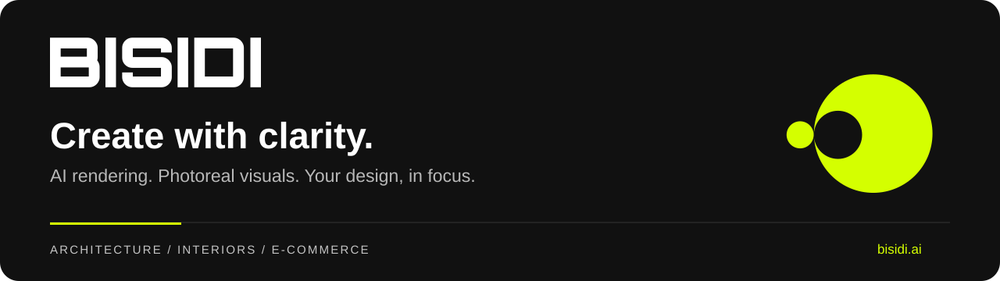

  <a href="https://bisidi.ai">Website</a> · <a href="https://app.bisidi.ai">Open BISIDI</a> · <a href="https://bisidi.ai/support">Support</a> · <a href="https://bisidi.ai/blog">Blog</a>

## From an idea to a photoreal visual

BISIDI helps architects, interior designers and brands turn sketches, photos and 3D models into polished images and videos. Create, refine and present your work in one browser-based workflow.

### What you can create

- **Architecture & interiors** — exterior and interior renders, high-rise and aerial views, and sketch or clay model visualizations.
- **Design refinement** — material transfer, object replacement, lighting and environment improvements, and people in context.
- **Products & e-commerce** — product visuals, photo-to-3D assets, and imagery for furniture, footwear, clothing and accessories.

### Start creating

[Explore the tools](https://bisidi.ai) · [Launch the app](https://app.bisidi.ai) · [Get help](https://bisidi.ai/support)

### Follow BISIDI

[LinkedIn](https://www.linkedin.com/company/bisidi/) · [YouTube](https://youtube.com/@bisidi_ai) · [Instagram](https://www.instagram.com/bisidi_ai) · [Pinterest](https://www.pinterest.com/BiSiDiai/)

---

BISIDI is operated by SIBIDI AI LTD, registered in England and Wales, company no. 16986135. [Company](https://bisidi.ai/company) · [Terms](https://bisidi.ai/terms) · [Privacy](https://bisidi.ai/privacy)
